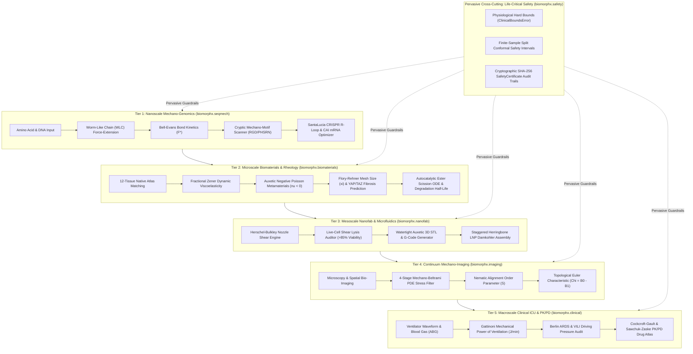
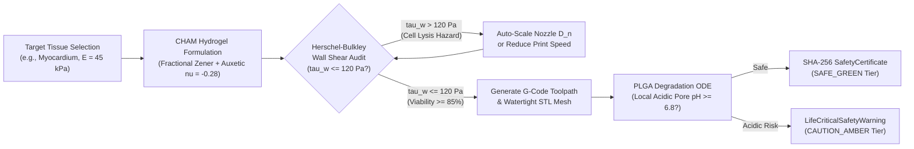
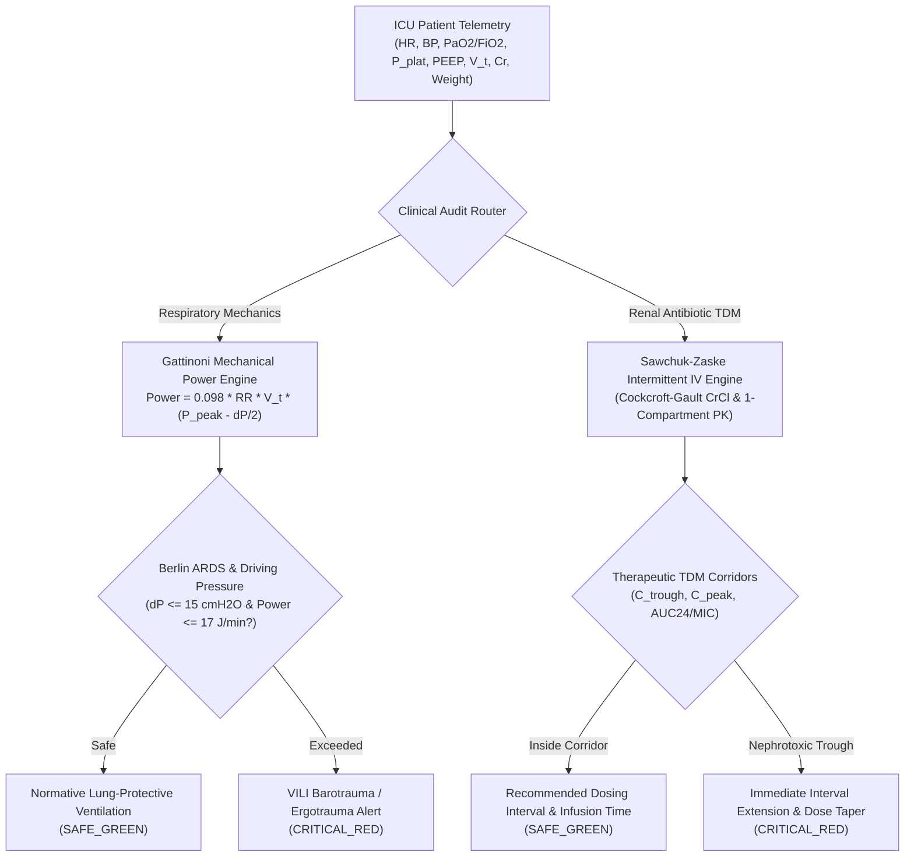

# BioMorphX (`biomorphx` v1.0.0)

[](LICENSE)
[](https://www.python.org/)
[](https://github.com/Runtime-Slayers/BioMorphX/actions/workflows/ci.yml)
[](https://pypi.org/)
[](#1-why-biomorphx-exists-solving-the-fragmentation-of-biomedical-computing)

> **Cross-Scale Mechano-Genomic, Biomaterial, Nanofabrication & Life-Critical Biomedical Engineering Python SDK**  
> Developed and maintained under the [**Runtime-Slayers**](https://github.com/Runtime-Slayers) organization.

---

## Table of Contents
1. [Why BioMorphX Exists](#1-why-biomorphx-exists)
2. [Omni-Scale Morpho-Mechanical Transduction Architecture](#2-omni-scale-morpho-mechanical-transduction-architecture)
3. [Core Submodules & One-Liner API Reference](#3-core-submodules--one-liner-api-reference)
4. [Auxetic Implant & Bioprinting Workflow](#4-auxetic-implant--bioprinting-workflow)
5. [Clinical ICU & Pharmacokinetic Safety Engine](#5-clinical-icu--pharmacokinetic-safety-engine)
6. [Installation & Distribution](#6-installation--distribution)
7. [Command-Line Interface & Built-In Snippets](#7-command-line-interface--built-in-snippets)
8. [Comprehensive Verification Suite & Visual Showcase](#8-comprehensive-verification-suite--visual-showcase)
9. [Repository Layout](#9-repository-layout)
10. [License](#10-license)

---

## 1. Why BioMorphX Exists

Modern biomedical engineering research suffers from deep computational fragmentation:
* **Sequence Libraries (`Biopython`)** treat DNA, RNA, and proteins as static 1D character strings, ignoring how macromolecules respond under piconewton forces (Worm-Like Chain persistence length, Bell-Evans unfolding force $F^*$, and cryptic motif exposure).
* **Image Processing Libraries (`scikit-image`, `OpenCV`)** diffuse pixel intensities through scalar Fickian heat equations or second-order Hessian eigenvalues, severing coherent speckle networks and erasing 3-way/4-way vascular and trabecular branching junctions.
* **Biomaterial, Bioprinting & ICU Systems** lack a unified engine bridging **Polymer/Hydrogel Rheology $\rightarrow$ 3D Auxetic Metamaterial G-Code/STL Generation with Nozzle Shear-Lysis Viability Auditing $\rightarrow$ Deterministic ICU Hemodynamic & Renal PK/PD Safety Guardrails**.

`biomorphx` compresses workflows that previously required **150 to 400 lines of custom multi-physics code** into **single-line, unit-checked, cryptographically hash-stamped function calls**.

---

## 2. Omni-Scale Morpho-Mechanical Transduction Architecture

BioMorphX bridges biological scales from single angstroms to whole-organ clinical dynamics through the **Omni-Scale Morpho-Mechanical Transduction (OMMT)** paradigm, governed at every boundary by mathematical safety certificates.



---

## 3. Core Submodules & One-Liner API Reference

| Submodule | Primary One-Liner Function | Replaces (~Lines) | Core Mathematical & Physical Engine |
| :--- | :--- | :---: | :--- |
| **`biomorphx.safety`** | `verify_bounds()`, `conformal_safety_interval()` | ~120 lines | Hard physiological survival bounds (`ClinicalBoundsError`), SHA-256 `SafetyCertificate`, finite-sample Split Conformal Prediction intervals ($1-\alpha$ marginal coverage). |
| **`biomorphx.seqmech`** | `analyze_mechano_protein(seq, ...)` | ~250 lines | Henderson-Hasselbalch $\text{pI}$, Kyte-Doolittle GRAVY, Bustamante-Marko-Siggia Worm-Like Chain (WLC) extension $x(F)$, Bell-Evans unfolding force $F^*\text{ (pN)}$, catch-bond lifetime $\tau(F)$, cryptic motif scanner (`RGD`, `PHSRN`, `IKVAV`, `GPQGIAGQ`). |
| **`biomorphx.seqmech`** | `design_crispr_mechano_guide(dna, ...)` | ~220 lines | SantaLucia (1998) nearest-neighbor $\Delta H^\circ, \Delta S^\circ, \Delta G^\circ_{37}, T_m$ coupled with sequence-dependent DNA persistence length $L_p$ and supercoiling torque $\tau = \frac{2\pi C \sigma}{\omega_0}$ for R-loop invasion efficiency. |
| **`biomorphx.seqmech`** | `optimize_mrna_construct(prot, ...)` | ~180 lines | Human Codon Adaptation Index ($\text{CAI}$) optimizer with homopolymer/hairpin avoidance and $5'/3'\text{ UTR}$ + poly(A) assembly. |
| **`biomorphx.biomaterials`** | `design_chrono_hydrogel(target_tissue, ...)` | ~300 lines | 12-tissue native atlas, Fractional Zener + 2nd-order Auxetic Metamaterial rheology, Flory-Rehner mesh size $\xi\text{ (nm)}$, Visco-Harmonic Phase Dichroism $\Delta\Phi_{\text{VH}}$, YAP/TAZ & Piezo1 fibrosis predictor. |
| **`biomorphx.biomaterials`** | `simulate_scaffold_degradation(polymer, ...)` | ~240 lines | Autocatalytic ester/MMP scission ODE, percolation modulus decay $E(t)/E_0$, local acidic pore $\text{pH}(t)$ necrosis guardrail, biphasic Korsmeyer-Peppas drug release. |
| **`biomorphx.nanofab`** | `generate_auxetic_gcode_and_stl(...)` | ~380 lines | Re-entrant bow-tie auxetic 3D Bioprinter `.gcode` + watertight 3D `.stl` mesh generator + Herschel-Bulkley non-Newtonian nozzle wall shear stress $\tau_w\text{ (Pa)}$ & live-cell viability (%) auditor. |
| **`biomorphx.nanofab`** | `simulate_lnp_nanocarrier(...)` | ~190 lines | Staggered herringbone microfluidic mixing time $\tau_{\text{mix}}$, Damköhler nanoprecipitation size $D_h\text{ (nm)}$, PDI, apparent $\text{pK}_a$, endosomal escape potency. |
| **`biomorphx.imaging`** | `mbsp_filter_and_quantify(image_2d, ...)` | ~320 lines | 4-Stage Mechano-Beltrami Stress-Percolation (MBSP) Filter + automated nematic alignment order $S$, branching junction density ($\text{nodes/mm}^2$), EDT pore diameter, and Euler characteristic $\chi = \beta_0 - \beta_1$. |
| **`biomorphx.clinical`** | `audit_icu_hemodynamics_ventilation(...)` | ~260 lines | MAP, Shock Index, Windkessel compliance, Berlin ARDS $\text{PaO}_2/\text{FiO}_2$ staging, Driving Pressure $\Delta P$, Gattinoni Mechanical Power of Ventilation ($\text{J/min}$) with VILI barotrauma guardrails. |
| **`biomorphx.clinical`** | `optimize_renal_pkpd_dosing(drug_name, ...)` | ~240 lines | Cockcroft-Gault $\text{CrCl}$, Sawchuk-Zaske intermittent IV infusion dosing, steady-state $C_{\max,\text{ss}}, C_{\min,\text{ss}}$, $\text{AUC}_{24}/\text{MIC}$, and nephrotoxicity trough guardrails. |

---

## 4. Auxetic Implant & Bioprinting Workflow

The following flowchart outlines the automated pipeline from patient tissue matching down to G-code execution, STL generation, and autocatalytic degradation tracking:



---

## 5. Clinical ICU & Pharmacokinetic Safety Engine

In critical care scenarios, BioMorphX executes deterministic physiological audit loops with hard boundary interrupts (`ClinicalBoundsError`) and real-time stratification:



---

## 6. Installation & Distribution

### Option 1: Install Directly from the GitHub Repository
```bash
pip install git+https://github.com/Runtime-Slayers/BioMorphX.git
```

### Option 2: Install from Pre-Built Wheel (Offline Immediate)
```bash
# Clone the repository
git clone https://github.com/Runtime-Slayers/BioMorphX.git
cd BioMorphX

# Install the wheel bundled in dist/
pip install ./dist/biomorphx-1.0.0-py3-none-any.whl
```

### Option 3: Developer / Editable Installation
```bash
git clone https://github.com/Runtime-Slayers/BioMorphX.git
cd BioMorphX
pip install -e .
```

### Option 4: Zero-Dependency Single-File SDK (`biomorphx.py`)
For air-gapped clinical workstations, embedded controllers, or HPC clusters, `biomorphx.py` is an autonomous drop-in SDK containing the entire engine in a single file with zero external dependencies beyond NumPy and SciPy.

---

## 7. Command-Line Interface & Built-In Snippets

BioMorphX provides a full CLI for executing self-tests and running standard translational workflows:

```bash
# Verify version
biomorphx --version

# Run deterministic self-test across all 12 pipelines
biomorphx self-test

# List all 12 built-in biomedical one-liner pipelines
biomorphx list-snippets

# View Python source code of any snippet
biomorphx show-snippet 06_bioprinter_gcode_and_stl

# Execute snippet directly with JSON output
biomorphx run-snippet 09_icu_ventilator_power_audit
```

### Python SDK Quickstart

```python
import biomorphx as bmx

# 1. Nanoscale Mechano-Genomic Single-Molecule Analysis
protein = bmx.analyze_mechano_protein(
    sequence="TVYAVTGRGDSPASSKPISINYRTEIDKPSQ",
    pH=7.4,
    applied_force_pN=12.0
)
print("Unfolding Force (pN):", protein["unfolding_force_pN"])
print("Bioactive Motifs:", protein["bioactive_motifs_detected"])

# 2. 3D Auxetic Metamaterial Bioprinting Toolpath & Mesh
fab = bmx.generate_auxetic_gcode_and_stl(
    width_mm=12.0,
    height_mm=12.0,
    layers=4,
    nozzle_diameter_um=200.0,
    print_speed_mm_s=8.0,
    out_gcode_path="examples/auxetic_myocardial_scaffold.gcode",
    out_stl_path="examples/auxetic_myocardial_scaffold.stl"
)
print("Cell Viability (%):", fab["predicted_cell_viability_pct"])
print("Auxetic Poisson Ratio:", fab["geometric_auxetic_poisson_ratio"])

# 3. ICU Hemodynamic & Ventilator Mechanical Power Audit
icu = bmx.audit_icu_hemodynamics_ventilation(
    hr_bpm=84,
    sbp_mmHg=118,
    dbp_mmHg=76,
    plateau_pressure_cmH2O=16.0,
    peak_pressure_cmH2O=22.0,
    peep_cmH2O=6.0,
    tidal_volume_ml=450.0
)
print("Mechanical Power (J/min):", icu["gattinoni_mechanical_power_J_min"])
print("Safety Certificate:", icu["safety_certificate"]["risk_tier"])
```

---

## 8. Comprehensive Verification Suite & Visual Showcase

BioMorphX ships with a 15-test life-critical verification suite (40+ assertions) validating every mathematical formula, boundary check, and output format.

```bash
python tests/test_biomorphx.py
```

Running the verification suite automatically generates the **6-panel publication-grade visual showcase dashboard**:
* **Panel A:** Worm-Like Chain (WLC) Single-Molecule Force Spectroscopy curves ($x(F)$ vs $F^*$).
* **Panel B:** 12-Tissue Native Atlas foreign-body fibrosis suppression with auxetic hydrogels ($\nu < 0$).
* **Panel C:** Autocatalytic scaffold degradation kinetics, modulus retention $E(t)/E_0$, and local pore pH necrosis alert.
* **Panel D:** Non-Newtonian Herschel-Bulkley nozzle shear stress vs. predicted live-cell viability across printing speeds.
* **Panel E:** 4-Stage Mechano-Beltrami Stress-Percolation (MBSP) filter with nematic alignment order $S$ and branching node detection.
* **Panel F:** Renal-adjusted vancomycin PK/PD therapeutic corridor and nephrotoxicity trough boundaries across creatinine clearance.

The rendered high-resolution figures are exported to:
- [`examples/biomorphx_sdk_showcase.png`](examples/biomorphx_sdk_showcase.png)
- [`examples/biomorphx_sdk_showcase.pdf`](examples/biomorphx_sdk_showcase.pdf)

---

## 9. Repository Layout

```text
BioMorphX/
├── .github/
│   └── workflows/
│       ├── ci.yml                     # Automated multi-OS, multi-Python test matrix
│       └── publish_pypi.yml           # Automated PyPI release workflow on tag
├── biomorphx/
│   ├── __init__.py                    # Clean submodule namespaces (safety, seqmech, etc.)
│   ├── cli.py                         # Console CLI entrypoint (biomorphx command)
│   └── core.py                        # Full cross-scale OMMT mathematical implementation
├── dist/
│   ├── biomorphx-1.0.0-py3-none-any.whl  # Pre-compiled Wheel for immediate offline pip install
│   └── biomorphx-1.0.0.tar.gz         # Source distribution tarball
├── docs/
│   └── README_BioMorphX_Installation_Guide.md.pdf # Comprehensive illustrated guide
├── examples/
│   ├── auxetic_myocardial_scaffold.gcode # Real generated 3D bioprinter toolpath
│   ├── auxetic_myocardial_scaffold.stl   # Watertight 3D printable auxetic mesh
│   ├── biomorphx_sdk_showcase.png        # 6-Panel publication-grade visual showcase
│   └── biomorphx_sdk_showcase.pdf        # High-res vector dashboard
├── tests/
│   └── test_biomorphx.py              # 15-Test life-critical verification suite
├── .gitignore                         # Python, OS, and build artifact exclusions
├── biomorphx.py                       # Standalone zero-dependency single-file SDK
├── biomorphx_developer_guide.md       # Extended API guide and derivation notes
├── install_on_any_laptop.sh           # Unix/macOS one-click automated installer
├── install_on_windows.bat             # Windows one-click automated installer
├── publish_to_public_pypi.sh          # PyPI distribution release script
├── pyproject.toml                     # PEP 517/518 build specification
├── setup.py                           # Setuptools package configuration
└── LICENSE                            # MIT License
```

---

## 10. License

BioMorphX is licensed under the [MIT License](LICENSE).  
Copyright (c) 2026 BioMorphX Research Consortium & [Runtime-Slayers](https://github.com/Runtime-Slayers).
